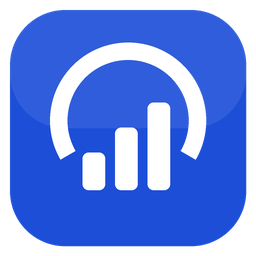

# token-tracker

 

Claude Code, Codex, Gemini CLI의 토큰 사용량과 남은 한도를 내 PC에서 바로 보는 도구예요.
화면 구석에 떠 있는 **한도 위젯**과 브라우저로 여는 **사용량 대시보드** 두 가지로 되어 있어요.

- 설치할 패키지 없음 (Python 표준 라이브러리만 사용)
- 사용량 기록은 내 PC에 저장돼요. 랭킹에 참가하면 닉네임, 요금제 이름, 기간별 금액만 공유 서버로 보냅니다.
- Windows와 macOS에서 돌아가요. Mac은 [Releases](https://github.com/hihikkul/token-tracker/releases/latest)의 DMG로 설치해요.

## 설치

1. **Python 3.10 이상**이 필요해요. 없으면 [python.org](https://www.python.org/downloads/)에서 설치하고, 설치 화면에서 *Add python.exe to PATH*를 체크하세요. (Anaconda도 됩니다)
2. 이 페이지 위쪽 초록색 **Code → Download ZIP**으로 받아서 원하는 폴더에 압축을 풀어요.
   git을 쓴다면 `git clone https://github.com/hihikkul/token-tracker.git`
3. 폴더 안의 **`install.bat`** 을 한 번 더블클릭해요. 바탕화면과 시작 메뉴에 **token-tracker** 아이콘이 생겨요.
4. 이제부터는 바탕화면의 **token-tracker** 아이콘을 누르면 실행돼요.
   - 화면 구석에 한도 위젯이 뜨고, 이미 켜져 있을 때 누르면 대시보드가 열려요.
   - 처음 켤 때는 기존 로그를 한 번 쭉 읽느라 몇 초에서 1분쯤 걸려요.
5. (선택) PC를 켤 때마다 자동으로 띄우고 싶으면 `install.bat` 대신 **`install_startup.bat`** 을 실행해요. 아이콘을 전부 지우려면 `uninstall.bat`.

압축을 푼 폴더는 지우거나 옮기지 마세요. 아이콘이 그 폴더를 가리켜요. 옮겼다면 `install.bat`을 다시 실행하면 돼요.

**업데이트는 자동이에요.** 위젯이 켜져 있으면 시작 직후와 1시간마다 GitHub에 새 버전이 있는지 보고, 있으면 받아서 스스로 다시 켜져요. 수동 확인은 대시보드의 **업데이트 확인** 또는 위젯 우클릭의 **Check for Updates**를 누르세요. 모은 기록과 설정은 `%LOCALAPPDATA%\TokenTracker`에 따로 있어서 그대로 남아요. 끄려면 설정에 `"auto_update": false` (git clone으로 받았다면 자동 업데이트 대신 `git pull`).

## macOS

1. [Releases](https://github.com/hihikkul/token-tracker/releases/latest)에서 내 Mac에 맞는 DMG를 받아요 (M1 이후 = `arm64`, Intel = `x86_64`).
2. 열어서 **Token Tracker**를 Applications로 끌어다 놓고 실행해요.
3. 서명하지 않은 앱이라 처음엔 "확인되지 않은 개발자" 경고가 떠요. **시스템 설정 → 개인정보 보호 및 보안 → 그래도 열기**를 누르면 돼요.
4. Claude Code 로그인 정보는 키체인에 있어서, 처음에 키체인 접근을 물어보면 **허용**을 눌러 주세요 (한도 조회용, 읽기만 해요).

Mac 앱은 스스로 덮어쓸 수 없어서, 새 버전이 나오면 위젯 우클릭 메뉴에 *Download vX* 가 생겨요. 기록과 설정은 `~/Library/Application Support/TokenTracker`에 있어요.

## 위젯 (Usage Limits)

- 화면 구석에 납작한 막대로 떠요. 각 도구에서 **가장 많이 소진된 한도**의 남은 양을 표시해요. 주간 한도가 소진되면 5시간 한도가 남아 있어도 0%로 보여요.
- 게이지 색: 넉넉할 땐 도구 색(Claude 주황, Codex 파랑), 절반 넘게 쓰면 노랑 → 주황(75%) → 빨강(90%)
- 마우스를 올리면 5h / Weekly 등 모든 한도와 리셋까지 남은 시간이 보여요
- Antigravity·Gemini CLI의 모델별 한도는 설명창에서 가장 적게 남은 한도 한 줄로 요약해요. 전체 모델 목록은 설명창의 대시보드 링크로 확인하세요.
- 드래그로 이동 · 더블클릭으로 대시보드 · 우클릭 메뉴 (Open Dashboard, Refresh Now, Minimize to Taskbar, Always on Top, Quit)
- **작업 표시줄에도 떠요.** 각 AI의 가장 빠듯한 한도를 반영한 뒤, 남은 비율이 가장 높은 AI를 아이콘에 표시해요. 모두 소진되면 0%로 표시합니다. 업데이트하면 기존 바탕화면·시작 메뉴 아이콘도 갱신해요.
- 막대에는 Claude, Codex, Antigravity처럼 짧은 앱 이름만 표시합니다. 주간·모델별 상세 한도는 설명창에서 확인하세요.
- 기존 글꼴 설정을 유지해요 (Calibri를 지정했다면 Calibri). 위젯·우클릭 메뉴·설명창은 영어, 대시보드는 한국어예요.
- 연결되지 않은 앱은 위젯·한도 카드에서 숨겨요. 설명창은 위·아래 공간에 맞춰 뜨고, 너무 긴 내용은 스크롤할 수 있어요.
- Claude 한도는 5분마다 Anthropic에 직접 조회하고, Codex 한도는 Codex가 마지막 응답 때 로그에 남긴 값이에요 (Codex를 쓰지 않는 동안은 갱신되지 않음).

## 대시보드

위젯의 ▤ 버튼, 또는 `python app.py --dashboard`. 주소는 http://127.0.0.1:8765/ 이고 내 PC에서만 열려요.

- 맨 위에 위젯과 같은 남은 한도 카드
- 총 사용 토큰, 최근 30일 토큰, 최근 30일 API 환산 비용
- 요일과 시간대별 사용량, 일별 모델별 토큰
- 입력·출력·캐시 비율, 캐시 적중률, 캐시로 아낀 비용
- 누적 비용(직전 같은 기간과 비교), 월별, 프로젝트, 모델
- **수집할 앱 선택**에서 Claude Code, Codex, ChatGPT, Gemini CLI, Antigravity, Gemini 웹을 따로 선택해요. 선택은 위젯·대시보드·쌀먹 비율에 함께 적용돼요.
- 기간(7/30/90일/전체), 도구, 단위(토큰/$) 전환. 모델이나 프로젝트를 누르면 그것만 걸러 봐요.

## 쌀먹 비율

대시보드 위쪽 카드. 같은 토큰을 API 정가로 썼다면 냈을 금액 ÷ 그 기간만큼의 구독료예요 (오늘 / 이번 주 / 이번 달).

- 구독료는 선택한 요금제의 정가로 정해요. 자동 감지는 한도 조회에서 읽은 요금제 가격을 사용합니다. Claude Pro $20 · Max 5x $100 · Max 20x $200, ChatGPT Plus $20 · Pro 100/200/500, Google AI Pro $19.99 · Ultra 5x $99.99 · Ultra 20x $249.99를 지원합니다.
- **요금제 선택**에서 사용 중인 요금제를 드롭다운으로 고르세요. 선택이 자동 감지보다 우선하며, USD 정가로 계산합니다. 연간 옵션은 월 환산액을 사용하고 세금·할인은 반영하지 않습니다. 무료·가격 미확인 요금제는 총 비율에서 제외하고 별도로 표시해요.
- 이번 달은 달력상 이번 달 사용량 ÷ **월 구독료 전액**으로 계산해요. 오늘은 월 구독료의 1/30, 이번 주는 7/30을 사용해요. 최근 30일 차트와 별개예요.
- Gemini CLI와 Antigravity를 함께 선택해도 Gemini 구독료는 한 번만 계산해요. ChatGPT와 Codex도 웹 항목 때문에 구독료가 추가되지 않아요.
- 이전 계산 방식으로 보낸 랭킹 점수는 새 점수와 섞지 않고 업데이트 필요로 표시해요.
- 여러 Codex 계정은 계정별 사용량·구독료·배율을 각각 표시합니다. 설정에서 계정별 요금제를 선택할 수 있으며, 같은 요금제의 서로 다른 계정도 합치지 않습니다. 계정 ID가 없는 로그나 확인된 세션 중 계정 전환 기록은 **계정 미확인**으로 표시하고 합계 배율에서 제외합니다. 전체 사용량 차트에는 그대로 포함합니다.

## 쌀숭이 랭킹

대시보드 오른쪽 위 **랭킹** 버튼. 친구들과 그룹을 만들어 일일 / 주간 / 월간 쌀먹 비율을 겨뤄요. 그룹 1등이 되면 처음 들어갈 때 축하해 줘요.

- *새 그룹 만들기*로 초대 코드를 받고, 친구는 *초대 코드로 참가*.
- 서버로 가는 건 닉네임, 요금제 이름, 기간별 API 환산 금액과 구독료 몫뿐이에요. 대화 내용, 프로젝트, 모델별 기록은 보내지 않아요. 15분마다 갱신돼요.
- 공유 서버는 Cloudflare Workers + D1 (`server/`)에서 운영 중이에요. 별도 서버 설치 없이 그룹을 만들거나 초대 코드로 참가하면 됩니다.
- 서버 주소: https://token-tracker-rank.hihikkul-token-tracker.workers.dev
- 친구에게는 **초대 링크 복사**로 복사한 공개 안내 링크를 보내세요. 친구도 트래커를 설치하고 본인 PC의 **랭킹 → 초대 코드로 참가**에서 참가해요. `127.0.0.1` 대시보드 주소는 친구에게 공유할 수 없어요.
- 오래된 설정의 localhost 랭킹 주소는 공개 서버로 교정해요. 개발 목적으로 로컬 서버를 쓸 때만 `ranking.allow_local_server: true`를 지정하세요.
- 별도 서버를 직접 운영하려면 `deploy_server.bat` (Mac은 `deploy_server.command`)로 본인 Cloudflare 계정에 배포할 수 있어요. Node.js와 Cloudflare 로그인이 필요합니다.

## 어디서 읽나요

| 도구 | 사용량 | 한도 |
|---|---|---|
| Claude Code | `~/.claude/projects/**/*.jsonl` | `api.anthropic.com/api/oauth/usage` (Claude Code 로그인 토큰 사용, 만료되면 갱신) |
| Codex | `~/.codex/sessions`, `archived_sessions` | 같은 로그의 `rate_limits` (네트워크 사용 안 함, 요금제별로 표시) |
| Gemini CLI | `~/.gemini/tmp/*/chats/*.json` | Gemini CLI 로그인 정보로 Google 모델별 잔여 한도 조회 |
| Antigravity | `~/.gemini/antigravity*`에서 토큰 수가 있는 기록만 | 실행 중인 앱의 로컬 서버에서 모델별 잔여 한도 조회 |
| ChatGPT / Gemini 웹 | 공개 토큰 기록 인터페이스 없음 | 공개 조회 인터페이스 없음: 조회 불가 안내 |

- ClaudeRipple 같은 프록시로 Claude Code 안에서 GPT·Gemini·DeepSeek 등이 답한 대화는 로그에 남은 실제 모델 이름을 보고 나눠 세요. GPT(ChatGPT 구독)는 **Codex**, Gemini는 **Gemini**, 나머지는 **Other models**로 집계되고 Claude 사용량에는 들어가지 않아요.
- claude.ai 웹·앱 대화는 PC에 토큰 기록이 남지 않아서 집계되지 않아요.
- 웹 항목은 선택할 수 있지만 Codex/Gemini CLI 기록을 웹 사용량으로 대신 표시하지 않아요. Antigravity가 토큰 기록을 제공하지 않는 버전이면 한도만 표시돼요. Gemini CLI는 먼저 CLI에서 로그인하고, Antigravity는 앱을 실행해주세요.
- Claude Code는 기본 30일이 지나면 로그를 지우지만, 트래커가 한 번 읽은 기록은 `usage.db`에 계속 남아요. 켜 둘수록 기록이 길어집니다.
- 비용은 **API 정가로 환산한 추정치**예요. 구독 실제 청구액이 아닙니다. 단가는 `prices.json`에서 고칠 수 있어요 (일부 모델은 공식이 아닌 가격표 기준이라 확인을 권해요).

## 설정

위젯 우클릭 **Settings** 또는 대시보드의 **설정**에서 앱 선택, 요금제, 글꼴, 불투명도, 항상 위 표시, 작업 표시줄 표시, 자동 업데이트를 변경하세요. 앱 선택·요금제·글꼴·불투명도·항상 위 표시는 바로 적용되며, 작업 표시줄·자동 업데이트 변경은 앱을 다시 실행하면 적용됩니다.

고급 설정 파일은 `%LOCALAPPDATA%\TokenTracker\config.json`입니다 (처음 실행할 때 생겨요).

- `sources`: 앱별 수집·표시 선택 (대시보드에서 변경, 기본 모두 선택)
- `widget.font`, `widget.number_font`: 글꼴 (비워 두면 Segoe UI Variable)
- `widget.taskbar`: 작업 표시줄 버튼과 % 아이콘 (기본 `true`)
- Windows에서 작업 표시줄에 고정할 때는 Token Tracker 기본 아이콘과 앱 실행 명령을 사용합니다. 이전 버전에서 고정한 Python 아이콘은 고정을 해제한 뒤 다시 고정하세요.
- 고정용 바로가기는 기본 아이콘을 사용하고, 실행 중 창은 실시간 사용량 아이콘을 사용합니다.
- `extra_paths`: 기본 위치 밖의 로그 폴더 추가. 예: `"claude": ["D:/backup/.claude/projects"]`
- `port` (8765), `scan_interval_sec` (60), `limits_interval_sec` (300)
- 환경변수 `CLAUDE_CONFIG_DIR`, `CODEX_HOME`, `GEMINI_HOME`, `TOKENTRACKER_HOME`도 따라가요.

## 문제가 생기면

`doctor.bat`을 실행하면 어떤 로그를 찾았는지, 몇 건 읽었는지, 한도 조회가 되는지 보여줘요.

- Claude 한도 엔드포인트는 비공식이라 바뀌면 한도 표시가 멈출 수 있어요 (사용량 집계는 계속 됨).
- Claude 한도는 Claude Code 로그인을 빌려 조회해요. 로그인은 몇 시간마다 갱신되고, 갱신 열쇠(refresh token)는 약 30일 동안 안 쓰면 끝나요. 트래커가 켜져 있는 동안 Claude Code와 같은 방식으로 계속 갱신해 두기 때문에, Claude Code CLI를 오래 안 써도 로그인이 유지돼요 (남은 기간이 7일 아래로 내려가면 미리 갱신).
- PC를 30일 넘게 꺼 뒀거나 다른 곳에서 로그아웃해서 로그인이 끝나면, 위젯에 **Claude · Sign in**이 떠요. 누르면 터미널에서 `claude auth login`이 열리고, 로그인을 마치면 몇 분 안에 한도가 다시 보여요. 이 동작을 끄려면 설정에 `"refresh_claude_token": false`.

## 라이선스

MIT. 포함된 D3는 ISC 라이선스입니다.
